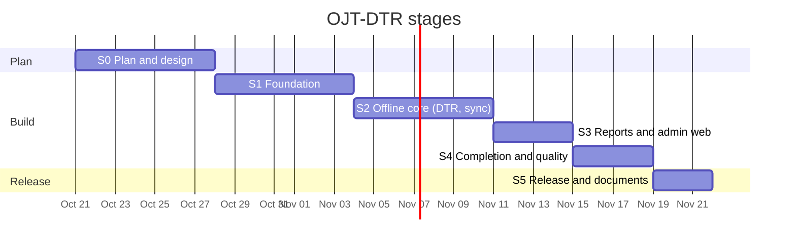

# Timeline

This document gives the stages, the weekly tasks, and the stage gate dates. The order of the stages follows the bottom-up approach. The lower layers come first.

Due date: 2026-11-21 (the default answer to Q-07 minus one week, D-29). S3, S4, and S5 are shorter than in the first plan. Move work to the cut list if a stage gate is at risk (R-02).

## 1. Stage overview

## 2. Stage tasks

### S0: Plan and design (2026-10-21 to 2026-10-27)

1. Write the module plan and the network plan (complete).
2. Write the requirements and the quality requirements (complete).
3. Write the test plan (complete).
4. Make the UI/UX design for each role.
5. Get answers to the open questions.
6. Do the S0 static tests. Write the S0 stage test report.

### S1: Foundation (2026-10-28 to 2026-11-03)

NOTE: 2026-11-01 and 2026-11-02 are holidays. Plan less work in this week.

1. Create the git repository and the CI workflow (lint and unit tests on each push).
2. Create the Supabase projects `dev` and `prod`. Write the migrations (schema and RLS), the seed data, and the Auth settings.
3. Make the auth module: login, refresh, logout, roles in `profiles`, RLS helper functions, the `admin-users` Edge Function.
4. Create the Ionic app. Add the Android platform. Add iOS only if a Mac is available.
5. Make the role shells and the route guards for OJT, facilitator, and admin.
6. Make the local database adapter (SQLite) and the local migrations.
7. Install each plugin. Do one test build on an Android device.
8. Set up the keep-alive sources and the backup workflow (runbook, sections 3 and 6). Make the first backup.

### S2: Offline core (2026-11-04 to 2026-11-10)

1. Make the outbox and the sync engine (push, pull, retry).
2. Make the database functions `sync_push` and `sync_pull`, and the server epoch.
3. Make the DTR module: time-in, time-out, work sessions, hours calculation, history.
4. Add the network, geolocation, and camera plugins to the DTR module.
5. Show the network status, the sync status, and the sync issues.
6. Do the network fault test, the app-stop test, and the backend-not-reachable test.

### S3: Reports, corrections, and admin web (2026-11-11 to 2026-11-14)

1. Make the weekly report module (draft, submit, review, approve, return).
2. Make the correction request module.
3. Make the facilitator views (OJT list, DTR review, report review).
4. Make the admin web modules: users, host companies, batches, assignments.
5. Deploy the admin web app to the static host (test site).

### S4: Completion and quality tests (2026-11-15 to 2026-11-18)

1. Make the monitoring dashboards for each role.
2. Make the PDF and CSV export.
3. Make the local reminders and the push notifications.
4. Make the audit log view.
5. Optional: make the iOS build if a Mac is available (D-15).
6. Do the system tests and the ISO/IEC 25010 quality tests.
7. Do the pause drill and the rebuild drill (runbook, section 5).

### S5: Release and documents (2026-11-19 to 2026-11-21)

1. Do the full regression test.
2. Do the user acceptance test for each role.
3. Deploy the production server and the admin web app. Build the release APK.
4. Write the user manuals and the developer setup guide.
5. Write the final test report.
6. Prepare the demonstration. Do the demonstration-day steps in the runbook, section 8.
7. Keep the keep-alive sources on until the final grade (runbook, section 9).

## 3. Milestones

| Date | Milestone |
|---|---|
| 2026-10-27 | S0 gate: plan and design approved |
| 2026-11-03 | S1 gate: login works for each role on Android and web. Keep-alive and backups are active. |
| 2026-11-10 | S2 gate: offline DTR works with zero data loss |
| 2026-11-14 | S3 gate: full report cycle works between two devices |
| 2026-11-18 | S4 gate: all functions complete, quality tests done |
| 2026-11-21 | S5 gate: release |
