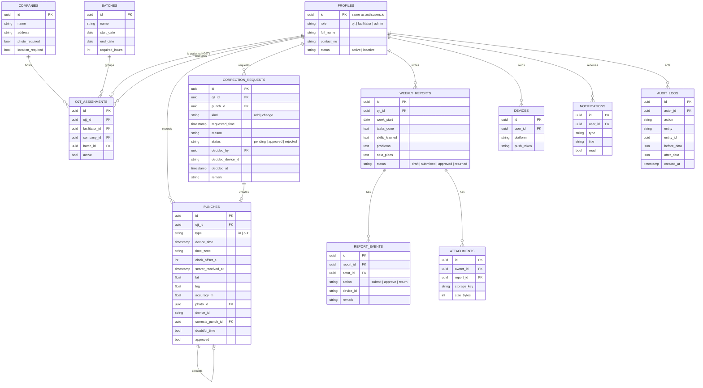

# Data model

This document gives the server data model (Supabase PostgreSQL). Supabase Auth keeps the email and the password hash in `auth.users`. The `profiles` table has the same ID. The local SQLite model on the mobile app is a subset of this model plus the sync tables (offline sync design, section 2).

## 1. Entity relationship diagram

## 2. Common columns

Each table that the mobile app syncs has these columns. The diagram does not show them.

| Column | Type | Purpose |
|---|---|---|
| `version` | int | Increases at each change. Used for the version check. |
| `created_at` | timestamp (UTC) | Server time of creation |
| `updated_at` | timestamp (UTC) | Server time of the last change |
| `deleted_at` | timestamp (UTC), null | Soft delete. A deleted record is sent as a tombstone in the pull. |
| `change_seq` | bigint | Server change number. It is the pull cursor (D-11). |

## 3. Sync tables on the server

| Table | Purpose |
|---|---|
| `processed_ops` | `op_id`, `user_id`, `result`, `processed_at`. Stops a second application of the same operation (FR-SYNC-05). |
| `ops.server_meta` | The server epoch (D-19) |
| `ops.heartbeat` | Keep-alive calls: source and time (runbook, section 3) |
| `ops.settings` | Keep-alive secret and other settings. Not readable by app roles. |

## 4. Rules

1. Store all timestamps in UTC. Clients show Asia/Manila time (A-04).
2. A unique index on `weekly_reports (ojt_id, week_start)` allows one report for each OJT for each week.
3. A unique index on `ojt_assignments (ojt_id)` where `active = true` allows one active assignment for each OJT (A-01).
4. No RLS policy or function lets a user change or delete `audit_logs` or `punches` (QR-SE-07, D-05).
5. A work session is not a table. The server and the app calculate work sessions from the punches in time order.
6. A work session belongs to the date of its time-in. This rule also applies when a session continues after midnight.
7. Each decision record (`correction_requests` decision, `report_events`) stores the user ID, the device ID, and the server time (QR-SE-06). The server sets `decided_at` and `created_at`.
8. Each table in `public` has RLS turned on. The `ops` schema is not exposed through the Data API, except the `heartbeat` function.
