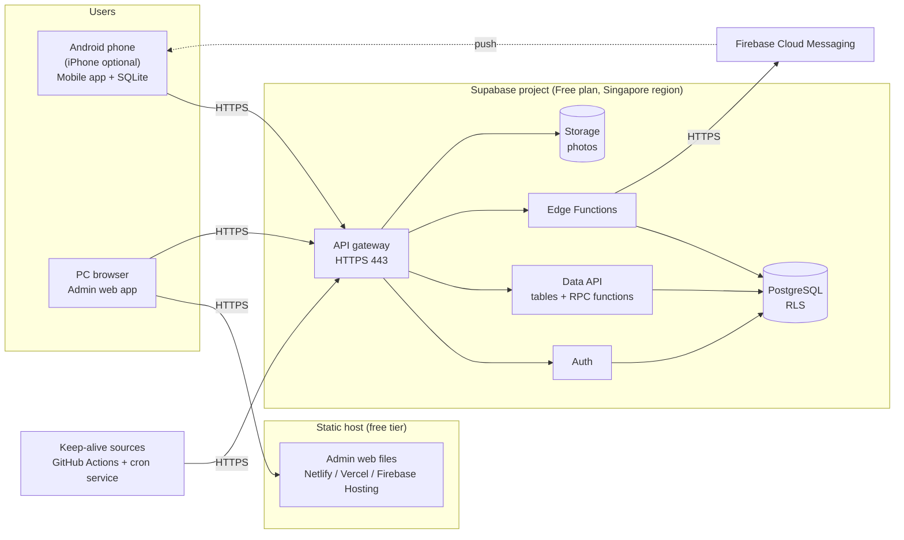
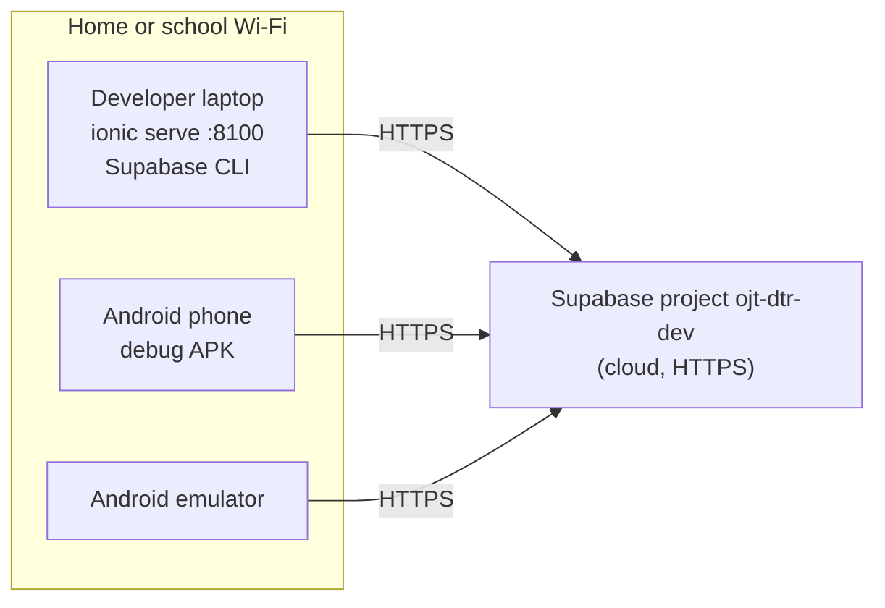

# Network infrastructure

This document gives the network infrastructure of the OJT-DTR system for development, test, and production. It is deliverable DL-02.

The system uses cloud services on free tiers only (D-16). The backend is Supabase on the Free plan (D-14). For the pause risk of the Free plan, see `docs/07-operations/free-tier-operations-runbook.md`.

## 1. Environments

| Environment | Purpose | Backend | Clients |
|---|---|---|---|
| Local (optional) | Tests that need a clean or third backend (rebuild drill) | Local Supabase stack (Supabase CLI and Docker) | `ionic serve`, Android emulator |
| Dev | Daily development, L2 to L4 tests | Supabase project `ojt-dtr-dev` | `ionic serve`, debug APK, admin web preview |
| Prod | Demonstration and user acceptance test | Supabase project `ojt-dtr-prod` | Release APK, production admin web URL |

Each environment has its own project URL, anon key, and secrets. Angular environment files hold the URL and the anon key for each build.

NOTE: The anon key is public by design. Row Level Security (RLS) protects the data. Never put the service role key in an app.

## 2. Production topology

### 2.1 Components

| Component | Function | Service (free tier) |
|---|---|---|
| Admin web app | Static files of the Angular web build | Netlify, Vercel, or Firebase Hosting |
| Auth | Login, sessions, token refresh | Supabase Auth |
| Data API | Table access for the admin web app. RPC calls to `sync_push`, `sync_pull`, and `heartbeat`. | Supabase Data API (PostgREST) |
| Database | PostgreSQL with RLS, database functions, triggers | Supabase PostgreSQL |
| Storage | Photos and attachments, with storage policies | Supabase Storage |
| Edge Functions | Functions that need secrets: push notifications, admin user creation and password reset, CSV export | Supabase Edge Functions |
| Push service | Push notifications to Android (and iOS if built) | Firebase Cloud Messaging |
| Keep-alive and backup jobs | Heartbeat calls and weekly backups | GitHub Actions, external cron service |

NOTE: Static hosts do not sleep. Only the Supabase project has an inactivity risk.

## 3. Network flows

| # | Source | Destination | Protocol | Port | Purpose |
|---|---|---|---|---|---|
| F1 | Mobile app | Supabase gateway | HTTPS (TLS 1.2+) | 443 | Login, `sync_push`, `sync_pull`, photo upload |
| F2 | Admin browser | Static host | HTTPS | 443 | Download the admin web app |
| F3 | Admin browser | Supabase gateway | HTTPS | 443 | Admin data access, Edge Function calls |
| F4 | Edge Functions | FCM | HTTPS | 443 | Send push messages |
| F5 | FCM | Mobile device | Platform push channel | Managed by the OS | Deliver push messages |
| F6 | GitHub Actions, cron service | Supabase gateway | HTTPS | 443 | Heartbeat calls |
| F7 | GitHub Actions (backup job) | Supabase session pooler | PostgreSQL over TLS | 5432 | Weekly database dump |
| F8 | Developer laptop | Supabase gateway and pooler | HTTPS, PostgreSQL over TLS | 443, 5432 | Supabase CLI: migrations, deploys |

NOTE: On the Free plan, the direct database connection uses IPv6 only. Tools on IPv4 networks must use the session pooler connection string.

## 4. Offline operation and the network

The mobile app does not need the network for offline functions (QR-RE-02). The network is necessary only for these actions:

1. The first login (FR-AUTH-01).
2. Sync push and sync pull (FR-SYNC-01, FR-SYNC-07).
3. Photo upload.
4. Push notifications (FR-NOTI-03).

The `@capacitor/network` plugin tells the app when the network status changes. "Network connected" does not mean "server available". If a request has a timeout, a 5xx error, or no response, the app shows "Server not reachable" (FR-SYNC-08). This also covers a paused Supabase project.

## 5. Security controls

| Control | Implementation | Requirement |
|---|---|---|
| Encryption in transit | HTTPS only. Supabase and the static host give TLS certificates. | QR-SE-02 |
| Authentication | Supabase Auth. JWT expiry 900 seconds. Refresh token rotation with reuse detection. | QR-SE-03 |
| Sign-up control | Public sign-up is off. Only the admin makes accounts (Edge Function). | FR-ADM-01 |
| Authorization | RLS policies on each table. Role and scope checks in each database function. | QR-SE-01 |
| Login attempts | Supabase Auth rate limits for sign-in, set in the dashboard | QR-SE-08 |
| Allowed origins | Auth redirect URLs list only the admin web domain and the app schemes | QR-SE-01 |
| Secrets | Service role key, FCM key, and keep-alive secret only in Edge Function secrets and GitHub secrets | AGENTS.md, rule 8 |
| Storage access | Private buckets. Storage policies by owner and assignment. | QR-SE-01 |
| Backups | Weekly encrypted own backup (runbook, section 6) | QR-RE-05 |
| Logs | Supabase keeps logs for 1 day. The project keeps `audit_logs` and the app sync log. | QR-MA-03 |

## 6. Development network

The phone and the emulator connect to the `dev` project over HTTPS. Thus, you do not need a LAN connection between the phone and the laptop, and you do not need cleartext HTTP.

NOTE: If you use the local Supabase stack, the emulator reaches the laptop at `10.0.2.2`. A phone needs the laptop IP address and a cleartext exception in the debug build only.

## 7. API surface summary

| Group | Interface | Used by |
|---|---|---|
| Auth | Supabase Auth: sign in, refresh, sign out, password change | All |
| Sync | RPC `sync_push(ops jsonb)`, RPC `sync_pull(cursor bigint, epoch uuid)` | Mobile |
| Read | Data API `select` on tables, filtered by RLS | Mobile (first load), web |
| Admin data | Data API on `companies` (with the photo and location settings), `batches`, `ojt_assignments`. Edge Function `admin-users` for accounts. | Web |
| Files | Supabase Storage buckets `selfies`, `attachments` | Mobile, web |
| Devices | Data API `insert` on `devices` (push token) | Mobile |
| Export | Edge Function `export-csv` | Web |
| Health | RPC `heartbeat(source, secret)` | Keep-alive sources, smoke test |

`system/backend/supabase/api-contract.md` is the full contract: each table, policy, function, and Edge Function (D-23, QR-CO-02).

## 8. Monitoring

1. The admin dashboard shows the newest heartbeat of each keep-alive source.
2. GitHub Actions and the cron service send an email when a call fails.
3. Supabase sends an email before it pauses a project.
4. The routine checklist in the runbook, section 7, runs two times each week.
5. The mobile app keeps a sync log of the last 200 events (QR-MA-03).

## 9. Capacity estimate against the Free plan

| Item | Estimate for one term | Free plan limit |
|---|---|---|
| Users | 500 OJTs, 50 facilitators, 3 admins | 50,000 monthly active users |
| Database | About 200,000 punches and related rows: below 150 MB | 500 MB |
| Photos | Selfie off by default. Report photos: about 2,000 x 300 KB = 600 MB | 1 GB storage |
| Egress | Sync payloads are small. Photos use thumbnails. | 5 GB |

CAUTION: If all host companies turn on the selfie setting, the storage limit will be exceeded. Keep selfies small and delete them after 60 days (runbook, section 1).

## 10. Physical network design

Not required. The user confirmed a cloud deployment design (Q-02).
