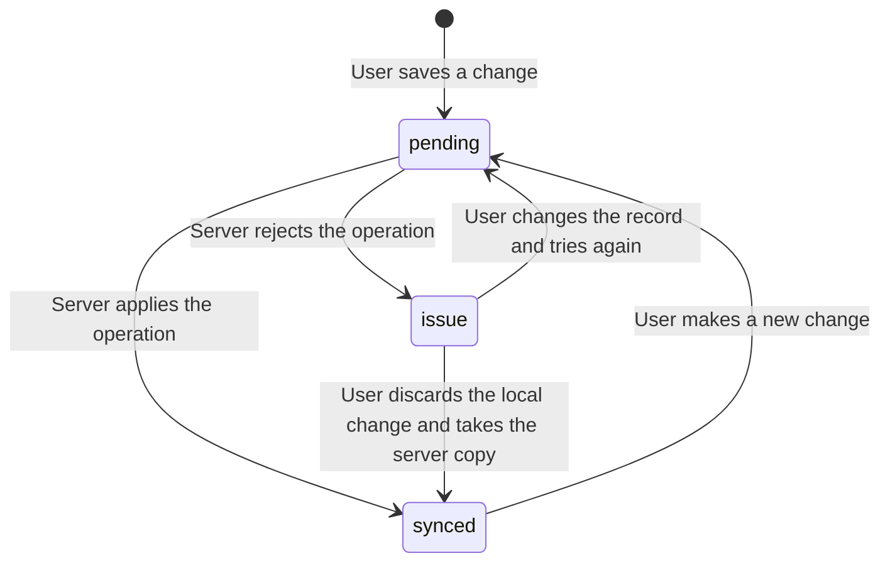

# Offline sync design

This document gives the design of the offline functions of the mobile app. The SYNC module is the base of all mobile modules. Read this document before you change a repository, the outbox, or the sync endpoints.

## 1. Design principles

1. **Local first.** The app writes each change to the local database first (FR-SYNC-01). The user does not wait for the network.
2. **Server is the source of truth.** The server validates each change. The server can reject a change.
3. **One write path.** The mobile app sends all changes through the database function `sync_push` (an RPC call).
4. **Idempotent operations.** Each operation has a unique `op_id`. The server applies each `op_id` one time only (FR-SYNC-05).
5. **Append-only punches.** The app never changes a punch. A correction makes a new punch (D-05).
6. **Fail safe.** The app never deletes a record with sync status `pending` or `issue` (QR-SF-03).

## 2. Local database tables

| Table | Contents |
|---|---|
| `user_profile` | The logged-in user, role, assignment, required hours |
| `punches` | DTR punches of the user (OJT) or of the assigned OJTs (facilitator) |
| `weekly_reports` | Weekly reports and their status |
| `report_events` | Status changes and remarks of reports |
| `correction_requests` | Correction requests and decisions |
| `notifications` | Notifications for the user |
| `attachments` | Local file path, upload status, server file ID |
| `outbox` | Operations that the server did not accept yet |
| `sync_state` | Pull cursor, last sync time, last clock offset |
| `sync_log` | The last 200 sync events, for fault analysis (QR-MA-03) |

Each synced table has these columns: `id` (UUID), `version`, `updated_at`, `deleted_at`, `sync_status`.

### 2.1 Outbox columns

| Column | Meaning |
|---|---|
| `op_id` | UUID of the operation. The client makes it (D-10). |
| `user_id` | UUID of the user who made the change. The sync engine sends only the operations of the logged-in user (section 9, item 5). |
| `entity` | Table name, for example `punches` |
| `entity_id` | UUID of the record |
| `op_type` | `create`, `update`, or `delete` |
| `payload` | JSON data of the change |
| `base_version` | Record version when the user made the change (for update and delete) |
| `created_at` | Device time when the user made the change |
| `attempts` | Number of send attempts |
| `last_error` | Last error from the server or the network |
| `status` | `queued`, `sending`, or `issue` |

## 3. Sync status of a record

## 4. Push procedure

1. The sync engine reads a maximum of 50 outbox operations with status `queued`, in `created_at` order.
2. The sync engine sets their status to `sending`.
3. The sync engine sends them in one RPC call to `sync_push`.
4. The `sync_push` function processes each operation in its own subtransaction (a `BEGIN ... EXCEPTION` block):
   1. If the `op_id` exists in the `processed_ops` table, the result is `duplicate`.
   2. If validation fails, the result is `rejected` with a cause code.
   3. If `base_version` is not the current version, the result is `conflict`.
   4. Else the server applies the change, writes the `op_id` to `processed_ops`, and the result is `applied`.
5. For `applied` and `duplicate`, the app removes the operation from the outbox. The app sets the record to `synced` and stores the server version.
6. For `rejected` and `conflict`, the app sets the operation and the record to `issue`. The record shows on the "Sync issues" screen (FR-SYNC-06).
7. If the request fails (no network, timeout, server error 5xx), the app sets the operations back to `queued` and increases `attempts`.
8. If more queued operations exist, go to step 1.

## 5. Pull procedure

1. The sync engine calls the RPC `sync_pull` with the cursor and the known epoch. The cursor is the last server change number (D-11).
2. The server returns the records that changed after the cursor, for the scope of the user. The response includes deleted records (tombstones).
3. The server returns a maximum of 500 records and a `has_more` flag.
4. The app writes each record to the local database:
   - If the local record has status `pending` or `issue`, the app keeps the local copy. The app stores the server version for the next push.
   - Else the app replaces the local record with the server record.
5. The app stores the new cursor.
6. If `has_more` is true, go to step 1.

### Scope of the pull

| Role | Data in the pull |
|---|---|
| OJT | Own profile, own assignment, own punches, reports, corrections, notifications |
| Facilitator | Own profile, assigned OJTs, their punches, reports, corrections, own notifications |

## 6. Sync triggers and retry

| Trigger | Source |
|---|---|
| The network changes from offline to online | `@capacitor/network` event |
| The app opens or comes back to the foreground | `@capacitor/app` event |
| The user saves a change and the network is available | Repository |
| The user does pull-to-refresh | Page (FR-SYNC-03) |
| Timer: every 5 minutes while the app is open | Sync engine (FR-SYNC-02) |

Only one sync can run at a time. If a trigger occurs during a sync, the engine runs one more sync after the current sync.

Retry delays after a failed request: 5 s, 15 s, 60 s, then 5 minutes for each next attempt. A network-online event resets the delay.

## 7. Conflict rules for each entity

| Entity | Who can write | Conflict rule |
|---|---|---|
| Punch | OJT (create only) | No conflict. Punches are append-only. |
| Weekly report content | OJT, only in status `draft` or `returned` | Version check. If the facilitator acted first, the server rejects the change. The app shows the new status. |
| Weekly report decision | Facilitator, only in status `submitted` | The first decision wins. A second decision gets `conflict`. |
| Correction request | OJT creates. Facilitator decides. | Same as weekly report decision. |
| Profile | User | Last write wins for contact number and photo. |
| Admin data (users, companies, batches) | Admin, online only | Version check in the REST endpoint. |

## 8. Clock integrity

A user can change the device clock when the device is offline. The system uses these controls:

1. At each successful sync, the app calculates `clock_offset = server_time - device_time` and stores it.
2. Each punch stores `device_time`, `time_zone`, `device_id`, and the last known `clock_offset`.
3. The server stores `server_received_at` for each punch.
4. The server sets the flag `doubtful_time` on a punch if one of these conditions is true:
   - The offset at the next sync differs from the stored offset by more than 5 minutes.
   - The punch time is more than 2 minutes after `server_received_at`.
   - The punch time is more than 7 days before `server_received_at`.
5. The facilitator sees the flag (FR-DTR-11). The facilitator decides when the facilitator approves the week.

## 9. Authentication offline

1. The access token can expire while the device is offline. This does not stop offline work.
2. Before a push, the app refreshes the access token.
3. If the refresh fails because the refresh token is expired or revoked, the app shows the login screen. The outbox stays.
4. If the refresh fails because of a network error, a timeout, or a 5xx error, the app keeps the session. It does not sign out (QR-RE-08).
5. The outbox belongs to one user ID. If a different user logs in on the device, the app does not send the outbox of the first user.

CAUTION: If a user logs out with unsynced changes, these changes can be lost. The app must show the count of unsynced changes and ask for confirmation (FR-AUTH-05, QR-SF-01).

## 10. Files (photos)

1. The app compresses each photo to 500 KB or less (QR-PE-05).
2. The app stores the photo in the app data folder. The `attachments` table stores the local path.
3. The sync engine uploads the file to Supabase Storage before it pushes the operation that refers to the file. If the server is not reachable, the sync stops and the retry uploads the file again. A file that exists in Storage counts as uploaded.
4. The Storage path is fixed: `<owner_id>/<attachment_id>.jpg` (D-49). The app makes the path offline and puts it in the operation payload. The `attachments` operation goes before the punch or report operation that refers to the photo. `sync_push` rejects an attachment record with no file (cause `file_missing`).
5. Logout removes the photo folder of the user (`photos/<owner_id>/`) with the local data.

## 11. Admin web app

The admin web app does not use the local database or the outbox (D-13). If the network is not available, the admin web app shows a message and disables the save actions.

## 12. Server epoch

The table `ops.server_meta` holds one `epoch` value (UUID). A rebuild of the backend sets a new epoch (runbook, procedure B, D-19).

1. Each `sync_pull` call sends the epoch that the app knows. The response contains the current epoch.
2. If the two epochs are different, the app does these steps:
   1. It sets the pull cursor to 0.
   2. It adds a `create` operation to the outbox for each own record of the last 30 days with status `synced`.
   3. It does a full pull.
3. `sync_push` finds existing records by their ID. For an existing record, the result is `duplicate`. Thus the second send is safe.

## 13. Backend not reachable

A paused Supabase project, a server fault, and a timeout are the same for the app. The app uses this table to set its state.

| Response | App state | App action |
|---|---|---|
| The network plugin reports no network | No network | Wait for the network event |
| Timeout, no response, DNS error, or 5xx error | Server not reachable (FR-SYNC-08) | Retry with the delays of section 6. Keep the session. |
| Access token expired (HTTP 401) | Normal | Refresh the token one time, then send again. A refresh with no network or a 5xx error is "Server not reachable". |
| Supabase Auth rejects the refresh token as invalid | Session ended | Show the login screen. Keep the outbox. |
| Operation result `rejected` or `conflict` | Sync issue | Show the record on the "Sync issues" screen |

The tolerance rules are also in the runbook, section 4.

NOTE: The app keeps the token expiry in device time (`expires_at` = device time at arrival + `expires_in`). Thus a device clock that is wrong does not make each new token look expired (DEF-012). With no network, a request fails at once (DEF-014). Only a change from offline to online starts a sync; the Android plugin repeats "connected" events (DEF-011).
