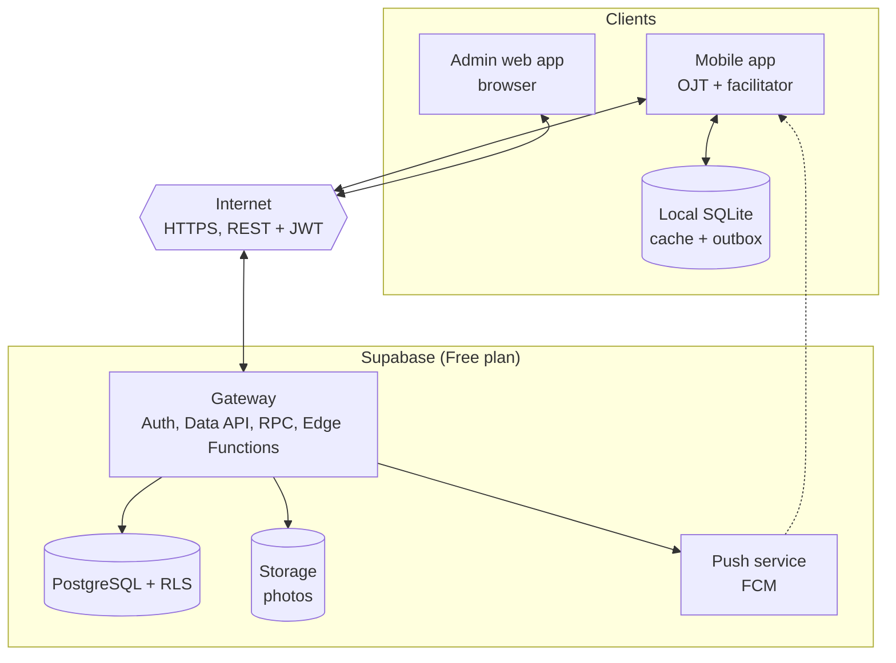
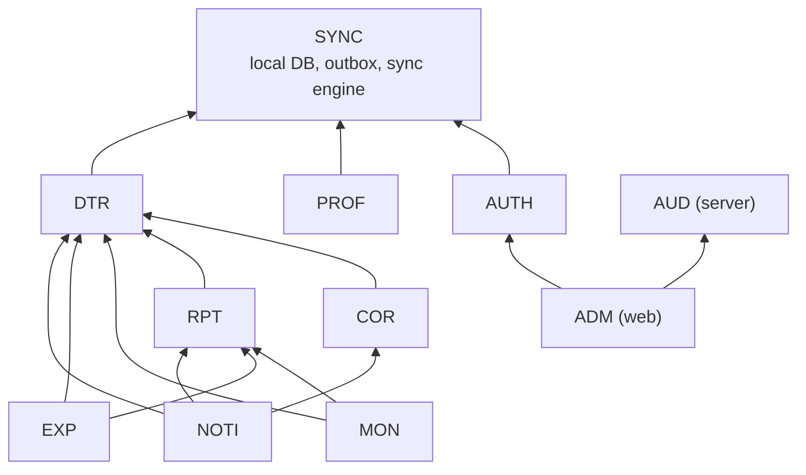
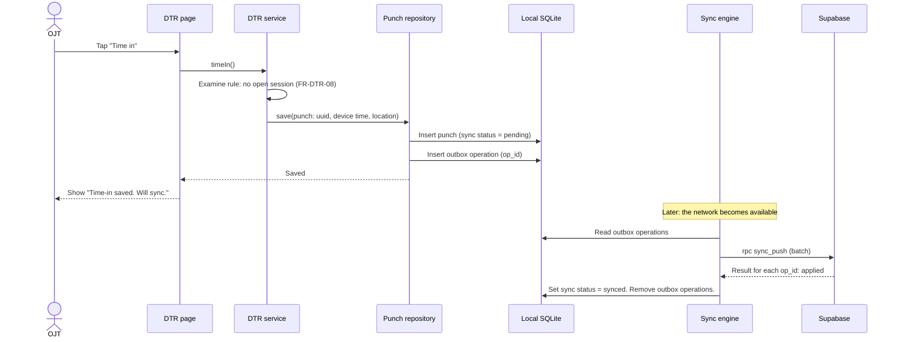
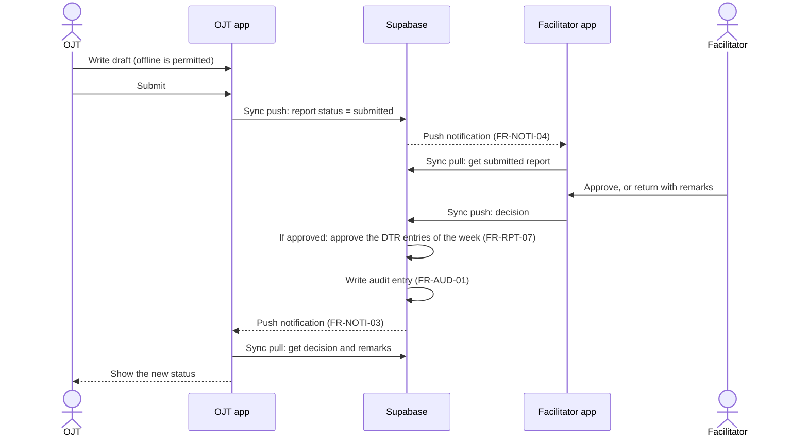

# System modules and module interactions

This document gives the modules of the OJT-DTR system and how they interact. It is deliverable DL-01.

## 1. System overview

The system has three parts:

1. **Mobile app** (Android; iOS optional) for the OJT and the facilitator. It keeps data in a local database and operates offline.
2. **Admin web app** for the admin. It operates online only (D-13).
3. **Backend**: Supabase on the Free plan (PostgreSQL with RLS, Auth, Storage, database functions, Edge Functions) and a push notification service (D-14).

The mobile app and the admin web app come from one Ionic Angular codebase (D-02).

## 2. Client layers

The client code has six layers. A layer can call only the layers below it. This order is also the build order and the test order (bottom-up, D-06).

| Layer | Name | Contents | Folder |
|---|---|---|---|
| 5 | Pages | Ionic pages and components for each feature | `features/` |
| 4 | Feature services and state | Business rules of the client, state stores (Angular signals), route guards | `features/*/`, `core/` |
| 3 | Repositories | One repository for each entity. The only path to data. | `data/repositories/` |
| 2 | Sync engine and outbox | Push, pull, retry, sync status | `data/sync/` |
| 1 | Storage and transport adapters | SQLite adapter, HTTP client, plugin wrappers | `data/local-db/`, `core/`, `plugins/` |
| 0 | Utilities | Time calculation, validation, UUID, date rules | `shared/` |

On the mobile app, a repository reads from the local database and writes to the local database and the outbox. On the admin web app, a repository calls the API directly.

## 3. Module catalogue

| # | Code | Module | Purpose | OJT | Facilitator | Admin | Offline |
|---|---|---|---|---|---|---|---|
| 1 | AUTH | Authentication and session | Login, routes for each role, token refresh, offline open, logout | Yes | Yes | Yes | Yes (after first login) |
| 2 | PROF | Profile | Own profile and assignment | Yes | Yes | No | Yes |
| 3 | DTR | Daily time record | Time-in, time-out, work sessions, hours, history | Records | Reviews | Views all | Yes |
| 4 | COR | Correction requests | Request, approve, or reject punch corrections | Requests | Decides | Audits | Queue |
| 5 | RPT | Weekly report | Draft, submit, review, approve, return | Writes | Reviews | Views all | Draft: Yes. Submit and review: Queue |
| 6 | MON | Progress monitoring | Hours progress and compliance views | Own | Assigned OJTs | All | Cached |
| 7 | NOTI | Notifications | Local reminders, push notifications, notification list | Yes | Yes | No | Local reminders: Yes |
| 8 | EXP | Export | DTR and report PDF, CSV summaries | Own | No | All | Yes (PDF from cache) |
| 9 | ADM | Administration | Users, host companies, batches, assignments, settings | No | No | Yes | No |
| 10 | AUD | Audit log | Record and show important changes | No | No | Yes | Not applicable |
| 11 | SYNC | Offline sync | Local database, outbox, push, pull, sync issues | Yes | Yes | No | It is the offline function |

## 4. Module dependencies

An arrow from A to B means "A uses B". The base module (SYNC) is at the top. A module must not use a module that is below it in this diagram.

### Dependency rules

1. Features do not import other feature folders. A feature uses another feature only through its repository in `data/repositories/` (QR-MA-01).
2. DTR is the base of COR, RPT, MON, and EXP. Build and test DTR first.
3. SYNC is the base of all mobile modules. Build and test SYNC before the mobile modules that use it.
4. AUD is a server module. Server services call it. Clients only read it.

## 5. Main interaction flows

### 5.1 Time-in when the network is not available

### 5.2 Weekly report cycle

### 5.3 Correction request

1. The OJT makes a correction request with a reason. The app keeps it in the outbox.
2. The sync engine sends the request. The facilitator app gets it at the next pull.
3. The facilitator approves or rejects the request with a remark.
4. If approved, the server makes a new punch that refers to the original punch (D-05).
5. The server writes an audit entry. The server sends a push notification to the OJT.
6. The OJT app gets the new punch at the next pull. The app calculates the hours again.

### 5.4 Login and offline open

1. The first login needs the network. Supabase Auth sends an access token and a refresh token. Then the app reads the profile and the role.
2. The app keeps the tokens in secure storage. The app keeps the profile in the local database.
3. The app does a full pull of the data for the user.
4. At the next app open, if the network is not available, the app uses the stored profile and role. The user can use all offline functions.
5. When the network is available, the app refreshes the access token before it sends the outbox.
6. If the refresh token is expired, the app asks the user to log in again. The outbox stays on the device. The sync continues after the login.

## 6. Role and platform access

The client route guards apply these rules. The server applies the same rules to each request (QR-SE-01).

| Route group | OJT on mobile | Facilitator on mobile | Admin on web |
|---|---|---|---|
| `/ojt/*` (home, DTR, reports, corrections, progress) | Yes | No | No |
| `/facilitator/*` (OJT list, reviews, decisions) | No | Yes | No |
| `/admin/*` (dashboard, users, companies, batches, assignments, audit) | No | No | Yes |
| `/profile`, `/notifications`, `/sync-issues` | Yes | Yes | No |

### 6.1 Platform restriction (FR-AUTH-03)

Supabase Auth gives tokens to each valid account. It does not know the client platform. Thus the rule has two parts (D-38):

1. After login, the client reads the role from `profiles`. If the role is not permitted on this platform, the client signs out at once and shows a message. The client stores no data for this user.
2. The server gives each role access only to the data of that role (QR-SE-01). A token that a client of the wrong platform got gives no more access.

## 7. Backend components (Supabase)

| Component | Responsibility | Interface |
|---|---|---|
| Auth | Login, refresh, sign-out, password change | Supabase Auth |
| `profiles`, `companies`, `batches`, `ojt_assignments` | Users, host companies, batches, assignments | Data API with RLS (admin writes) |
| `sync_push` function | Applies the outbox operations of mobile clients | RPC |
| `sync_pull` function | Returns the changes after a cursor, for the scope of the user | RPC |
| DTR, report, and correction rules | Status machines, week approval, doubtful-time flag | Database functions and triggers, called by `sync_push` |
| Audit triggers | Write `audit_logs` for each event in FR-AUD-01 | Triggers |
| Storage | Photos and attachments | Private buckets with storage policies |
| `admin-users` Edge Function | Make and deactivate accounts, reset passwords | HTTPS (admin only) |
| `push-notify` Edge Function | Send FCM messages after a decision | Called by a database trigger |
| `export-csv` Edge Function | CSV summaries for the admin | HTTPS (admin only) |
| `heartbeat` function | Keep-alive and smoke test | RPC (needs the keep-alive secret) |

The admin web app uses the Data API and the Edge Functions. The mobile app writes only through `sync_push`. This gives one write path for offline changes.
