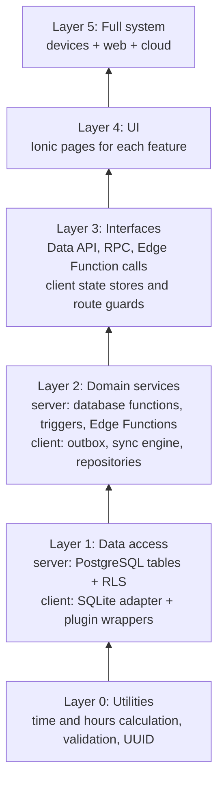

# Test plan

This document is the master test plan of the OJT-DTR system. It gives the test approach, the test levels, the test types, and the stage gates. Each development stage must obey this plan. The structure follows the test plan content of ISO/IEC/IEEE 29119-3.

## 1. Scope

### 1.1 Items to test

1. Mobile app (Android; iOS optional) for the OJT and facilitator roles.
2. Admin web app.
3. Supabase backend: tables, RLS policies, database functions, Edge Functions, storage policies.
4. Capacitor plugin integration.
5. Deployment, operation procedures (keep-alive, backup, resume, rebuild), and documents.

### 1.2 Items not to test

1. The internal functions of third-party services (Supabase, FCM, the static host, the Capacitor plugins). The project tests only its own use of these services.
2. Functions in the charter, section 2.2 (out of scope).

## 2. References

| Document | Location |
|---|---|
| Functional requirements | `docs/02-requirements/functional-requirements.md` |
| Quality requirements (ISO/IEC 25010:2023) | `docs/02-requirements/quality-requirements-iso25010.md` |
| System modules | `docs/03-architecture/system-modules.md` |
| Offline sync design | `docs/03-architecture/offline-sync-design.md` |
| Test case register | `docs/05-testing/test-cases.md` |
| Defect log | `docs/05-testing/defect-log.md` |

## 3. Test approach: bottom-up

This project uses the bottom-up approach (D-06). The team tests the lowest layers first. Then the team adds and tests one layer at a time, up to the full system.

### 3.1 Reasons for bottom-up

| Factor | Bottom-up | Top-down | Effect on this project |
|---|---|---|---|
| Location of the highest risk | Tested first | Tested last | The highest risk is in the low layers: the local database, the outbox, and the sync engine (R-01). |
| Dependencies | All mobile modules depend on SYNC and DTR | - | A fault in SYNC causes faults in all modules. Find it early. |
| Test helpers needed | Drivers (test code that calls a unit) | Stubs (fake lower modules) | Drivers are the normal unit test files. They cost little. A stub of the sync engine would hide the main risk. |
| Build order | Same as the timeline (S1 data and auth, S2 sync and DTR, S3 reports) | Different | The test order agrees with the build order. |
| Early visible UI | Late | Early | Weak point. See section 3.2. |

### 3.2 Control of the weak points

Bottom-up does not show the full UI early. The plan uses three controls:

1. In S0, do a walkthrough of the UI prototype with users (TC-ST-REV-03).
2. In S1, make simple role shells and test the login on a device (TC-SI-AUTH-01).
3. At each stage gate, show the new functions on a real device.

### 3.3 Integration order

| Layer | Test level | Drivers | Stubs and fakes |
|---|---|---|---|
| 0 | L1 Unit | Unit test files | None |
| 1 | L1 Unit, L2 Component integration | Unit test files, migration scripts | Node SQLite library behind the same adapter interface |
| 2 | L1 Unit, L2 Component integration | Unit test files | Fake plugin wrappers (network, geolocation, camera). Fake push sender. |
| 3 | L2 Component integration | Vitest + supabase-js, signed in as each test user | Fake FCM sender |
| 4 | L2 Component tests, L3 Subsystem integration | Angular component test harness, Playwright | None for the backend (use the `dev` project) |
| 5 | L4 System, L5 Acceptance | People with scripts, Playwright | None |

## 4. Test levels

| Level | Code | Objective | Basis | Tools | Environment | Who |
|---|---|---|---|---|---|---|
| L1 Unit | U | Each function and service is correct alone | Requirements, design, code | Backend: Vitest for Edge Functions, pgTAP (optional) for database functions. Frontend: the test runner that the Angular CLI sets up. | Developer laptop, CI | Developer, agents |
| L2 Component integration | CI | Two or more units operate together. Each endpoint obeys its contract and its access rules. | Architecture, API contract | Vitest + supabase-js against `dev` or the local stack, pgTAP (optional), Node SQLite library | Developer laptop, CI | Developer, agents |
| L3 Subsystem integration | SI | The mobile app and the server operate together on a real device and network | Offline sync design, flows | Android phone and emulator, `dev` project, fault injector | Local and test environments | Developer |
| L4 System | ST | The full system meets the functional and quality requirements | All requirements | Playwright, devices, k6 or autocannon, OWASP ZAP, axe, SUS form | Test environment | Developer, test users |
| L5 Acceptance | UAT | Real users can do their work with the system | User scripts, quality in use measures | Devices, scripts, SUS form | Test or production environment | Users of each role |

### 4.1 Fault injector

The project has no own server (D-20). Test builds of the app give supabase-js a wrapped `fetch` function. A test setting turns on the wrapper. The wrapper can drop a request, add a delay, or return error 500 at a set rate. Use it for TC-SI-SYNC-02 and TC-SI-SYNC-06.

CAUTION: Do not put the fault injector in a release build. TC-ST-Q-SE-02 examines the release build.

### 4.2 Supabase projects for tests

1. L2 to L4 tests use the `dev` project and the seed accounts.
2. Tests that reset data or need a clean backend use the local stack (D-21).
3. Before each test session, make sure that `dev` is active. If it is paused, do runbook procedure A.

## 5. Test types and ISO/IEC 25010 coverage

| Characteristic | Test types | Levels | Main test cases | Stage |
|---|---|---|---|---|
| Functional suitability | Functional tests, hours data set, requirement coverage | U, CI, SI, ST | TC-U-UTIL-*, TC-ST-OJT-*, TC-ST-FAC-*, TC-ST-ADM-* | S1 to S5 |
| Performance efficiency | Time measures, load test, size measures | ST | TC-ST-Q-PE-01 to TC-ST-Q-PE-04 | S2 (first measure), S4 |
| Compatibility | Device and browser matrix, contract test, export open test | CI, ST | TC-ST-Q-CO-01, TC-ST-Q-CO-02, TC-CI-EXP-02 | S4 |
| Interaction capability | Prototype walkthrough, usability test, SUS, accessibility test | ST, UAT | TC-ST-REV-03, TC-ST-Q-IC-01 to TC-ST-Q-IC-03 | S0, S4, S5 |
| Reliability | Offline tests, network fault test, app-stop test, backend-down test, keep-alive check, pause drill, rebuild drill | SI, ST | TC-SI-SYNC-02, TC-SI-SYNC-03, TC-SI-SYNC-06, TC-SI-SYNC-07, TC-ST-Q-RE-01 to TC-ST-Q-RE-05 | S1, S2, S4 |
| Security | Access matrix tests, auth tests, scans, log review | U, CI, ST | TC-CI-ACL-*, TC-U-AUTH-*, TC-ST-Q-SE-* | S1 to S4 |
| Maintainability | Static analysis, coverage, architecture rules | All (in CI) | TC-ST-Q-MA-01 | Each gate |
| Flexibility | Build test on three platforms, install test, setup test | ST | TC-ST-Q-FL-01, TC-ST-Q-CO-01 | S4, S5 |
| Safety | Data protection tests (warnings, fail safe, denied permissions) | U, ST | TC-U-SYNC-06, TC-U-DTR-04, TC-ST-Q-SF-01 | S2, S4 |

## 6. Network conditions for offline tests

Each test case for an offline function gives the network conditions that apply.

| Code | Condition | How to make it |
|---|---|---|
| N1 | Online, stable | Normal Wi-Fi |
| N2 | Offline | Airplane mode on the device. In Playwright: `context.setOffline(true)`. |
| N3 | Offline to online during work | Turn off airplane mode in the middle of the test |
| N4 | Online to offline during a sync | Turn on airplane mode while the sync runs |
| N5 | Slow network | Android developer options or the browser "Slow 3G" profile |
| N6 | Network up, server down or faulty | Turn on the fault injector at 100%. In the pause drill only: pause the `dev` project. |
| N7 | Token expired while offline | Set a short JWT expiry in the `dev` Auth settings. Stay offline longer than the refresh token life. |

## 7. Common gate rules

These rules apply to the gate of each stage.

| # | Rule |
|---|---|
| G1 | Run all test cases planned for the stage (see the "Stage" column in `test-cases.md`). |
| G2 | All test cases for "Must" requirements pass. Each failed "Should" or "Could" test case has a defect record. |
| G3 | Zero open S1 and S2 defects in the scope of the stage. |
| G4 | Zero lint errors. The type check passes. The build passes for each target platform of the stage. |
| G5 | The regression suites of all earlier stages pass (section 9). |
| G6 | Coverage meets QR-MA-05 for the code of the stage. |
| G7 | The stage test report is in `docs/05-testing/reports/`. |
| G8 | `PROGRESS.md` shows the gate result. |
| G9 | From S1: the keep-alive check passes (TC-ST-Q-RE-05). |

If a gate fails, do not start the next stage. Fix the defects. Then run the failed test cases and the regression suites again.

## 8. Stage gates

### S0: Plan and design (2026-10-21 to 2026-10-27)

| Item | Content |
|---|---|
| Entry criteria | Charter draft exists. |
| Test items | Requirements, architecture, UI prototype, this test plan |
| Tests | TC-ST-REV-01 (requirement review), TC-ST-REV-02 (design review), TC-ST-REV-03 (UI prototype walkthrough) |
| Exit criteria | All review defects closed. Each "Must" FR maps to a module and to one or more test cases. The user accepts the default answers or gives answers to Q-01 to Q-08. The user accepts this test plan. |

### S1: Foundation (2026-10-28 to 2026-11-03)

| Item | Content |
|---|---|
| Entry criteria | S0 gate passed. Node.js, Ionic CLI, the Android SDK (Android Studio or the command-line tools), and the Supabase CLI are installed. The two Supabase projects exist. |
| Test items | Layers 0 and 1. Auth module. Role shells. Local database adapter. Plugin installation. Keep-alive and backup jobs. |
| Tests | L1: TC-U-UTIL-01 to TC-U-UTIL-05, TC-U-AUTH-01 to TC-U-AUTH-04. L2: TC-CI-DB-01, TC-CI-DB-02, TC-CI-AUTH-01 to TC-CI-AUTH-03, TC-CI-ACL-03. L3: TC-SI-AUTH-01, TC-SI-PLUG-01. L4: TC-ST-Q-RE-05. |
| Exit criteria | Common gate rules. The CI workflow runs lint, L1, and L2 tests on each push. Login works for each role on Android and on the web. Keep-alive sources A, B, and C are set up. The first own backup exists. |

### S2: Offline core (2026-11-04 to 2026-11-10)

| Item | Content |
|---|---|
| Entry criteria | S1 gate passed. |
| Test items | Layer 2 and 3 for DTR and SYNC. DTR pages. Network, geolocation, and camera plugins. |
| Tests | L1: TC-U-DTR-*, TC-U-SYNC-*, TC-U-SRV-01. L2: TC-CI-SYNC-*, TC-CI-ACL-01, TC-CI-FILE-01. L3: TC-SI-AUTH-02, TC-SI-SYNC-01 to TC-SI-SYNC-07, TC-SI-FILE-01. L4: TC-ST-OJT-01, TC-ST-OJT-03, TC-ST-OJT-04, TC-ST-Q-PE-01 (first measure). |
| Exit criteria | Common gate rules. TC-SI-SYNC-02 (zero data loss), TC-SI-SYNC-03 (app stop), and TC-SI-SYNC-06 (backend not reachable) pass. |

### S3: Reports, corrections, and admin web (2026-11-11 to 2026-11-14)

| Item | Content |
|---|---|
| Entry criteria | S2 gate passed. |
| Test items | RPT, COR, facilitator views, ADM, test deployment |
| Tests | L1: TC-U-RPT-*, TC-U-COR-01. L2: TC-CI-RPT-*, TC-CI-ADM-01, TC-CI-ACL-02, TC-CI-AUD-01. L3: TC-SI-RPT-01, TC-SI-COR-01. L4: TC-ST-FAC-01, TC-ST-ADM-01 (part), TC-ST-ADM-02, TC-ST-ACC-01. |
| Exit criteria | Common gate rules. The report cycle passes in conditions N1, N2, and N3. The access matrix tests pass 100%. |

### S4: Completion and quality tests (2026-11-15 to 2026-11-18)

| Item | Content |
|---|---|
| Entry criteria | S3 gate passed. Test environment deployed with seed data. |
| Test items | MON, NOTI, EXP, AUD views, iOS build (optional). All quality requirements. Pause drill and rebuild drill. |
| Tests | L1: TC-U-MON-01. L2: TC-CI-EXP-*. L3: TC-SI-NOTI-01. L4: all TC-ST-OJT-*, TC-ST-FAC-*, TC-ST-ADM-*, and all TC-ST-Q-* test cases. |
| Exit criteria | Common gate rules. Each quality requirement has a measured result in the S4 report. Each "Must" QR passes, or the user accepts a waiver in the decision log. |

### S5: Release (2026-11-19 to 2026-11-21)

| Item | Content |
|---|---|
| Entry criteria | S4 gate passed. Production environment deployed. |
| Test items | Release build, production deployment, documents |
| Tests | Full regression (all automated suites and all TC-ST-* "Must" cases). TC-ST-DEP-01. TC-ST-Q-FS-01. TC-UAT-OJT-01, TC-UAT-FAC-01, TC-UAT-ADM-01. TC-ST-REV-04 (document review). |
| Exit criteria (release criteria) | 100% of "Must" FRs pass (QR-FS-01). Zero open S1 and S2 defects (QR-RE-01). Five or fewer open S3 defects, each with a workaround in the release notes. Quality in use targets met. Documents complete. |

## 9. Regression rules

1. The CI workflow runs all L1 and L2 tests on each push.
2. At each stage gate, run the L3 and L4 test cases of all earlier stages again. Exception: you can skip a manual test case if no code in its modules changed. Record the skip in the stage report.
3. When you fix a defect, add a test case that finds that defect. Then run the regression suite of the affected module.

## 10. Test environment and test data

### 10.1 Devices

| Device | Use |
|---|---|
| Reference Android phone (Android 11 or later) | L3, L4, time measures |
| Second Android phone, or emulator | Second user in two-device tests |
| Android emulator with an old supported Android version | Compatibility |
| iPhone of a tester, and a Mac for the build (optional, D-15) | iOS tests |
| PC with Chrome, Edge, Firefox (and Safari if available) | Admin web tests |

### 10.2 Seed accounts

| Account | Role | Purpose |
|---|---|---|
| `ojt1@test.local` to `ojt5@test.local` | OJT | Normal OJTs, assigned to `fac1` |
| `ojt6@test.local` | OJT | Assigned to `fac2`. Used in access matrix tests. |
| `fac1@test.local`, `fac2@test.local` | Facilitator | Two facilitators with different OJTs |
| `admin@test.local` | Admin | Admin tests |

The seed script also makes the volume data in the quality requirements, section 2. Use the seed data only in the local and test environments.

## 11. Defect management

### 11.1 Severity

| Severity | Meaning | Example |
|---|---|---|
| S1 Critical | Data loss, security breach, or a crash in a core flow. No workaround. | A punch made offline does not reach the server. |
| S2 Major | A "Must" requirement fails. The workaround is difficult. | A facilitator cannot return a report. |
| S3 Minor | A function fails. An easy workaround exists. | The filter on the admin dashboard does not reset. |
| S4 Trivial | Text, layout, or color problem | A label is cut off. |

### 11.2 Procedure

1. Record each defect in `defect-log.md` with a new DEF-NNN ID.
2. Write the steps, the expected result, the actual result, the device, and the network condition.
3. Fix S1 and S2 defects before other work.
4. After the fix, run the test case again and the module regression suite.
5. Set the status to "Closed" only when the test case passes.

## 12. Suspension and resumption

| Suspend tests when | Resume when |
|---|---|
| The build fails. | The build passes. |
| The `dev` project is paused or not available for more than 1 hour. | Do runbook procedure A. Record the pause as a defect. Run the interrupted test case from its start. |
| An S1 defect blocks more than 30% of the stage test cases. | The defect is fixed and its test case passes. |

## 13. Test deliverables

| Deliverable | Location | When |
|---|---|---|
| Test plan (this document) | `docs/05-testing/test-plan.md` | S0 |
| Test case register | `docs/05-testing/test-cases.md` | S0, updated each stage |
| Automated test code | `system/frontend/**/*.spec.ts`, `system/backend/tests/`, `system/backend/supabase/tests/` | S1 to S5 |
| Defect log | `docs/05-testing/defect-log.md` | S1 to S5 |
| Stage test reports | `docs/05-testing/reports/S<n>-test-report.md` | At each gate |
| Final test report | `docs/05-testing/reports/final-test-report.md` | S5 |

## 14. Roles

| Role | Tasks |
|---|---|
| Developer | Writes and runs automated tests. Runs device tests. Writes the reports. |
| AI agents | Write test code from the test cases. Run automated tests. Must obey section 15. |
| Test users | Do the usability test and the UAT. Classmates or OJT students can be test users. |
| Teacher or user | Accepts the test plan and the waivers. |

## 15. Rules for AI agents

1. Write each test from the requirement and the test case. Do not write a test from the code only.
2. Do not change a test to make it pass. If a test is wrong, record the reason in the stage report and in the session log.
3. Do not skip, disable, or delete a test without a decision in the decision log.
4. Run the related tests before you mark a task complete. Report the real result.
5. Put the test case ID in the name of each automated test. Example: `it('TC-U-DTR-01 rejects time-in when a session is open', ...)`.
6. Do not run tests against the production environment, except TC-ST-DEP-01 and TC-ST-Q-RE-05.

## 16. Test risks

| Risk | Effect | Control |
|---|---|---|
| Only one person tests the work of that person. | Faults are not found. | Write tests from requirements. Use test users for L4 and L5. Ask a classmate to do the setup test (TC-ST-Q-FL-01). |
| Manual device tests take much time. | Stage slips. | Automate as much as possible in L1, L2, and Playwright. Keep manual tests for device-only functions. |
| No Mac for iOS. | No iOS test. | iOS is optional (D-15). Record the limit in the S4 report. |
| The Free plan compute is small and shared. | Slow performance results. | Record the compute size. Compare results only on the same plan. |
